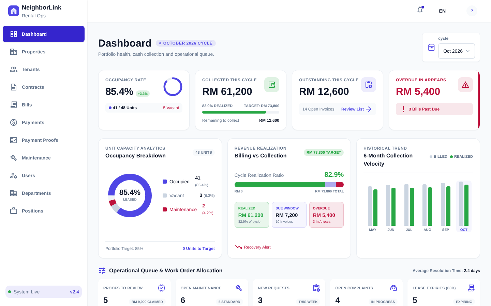
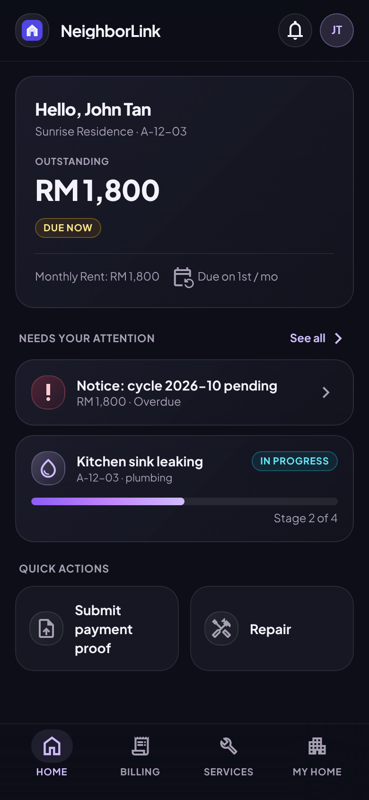

<div align="center">

# NeighborLink

**A rental property management system with a tenant portal and an admin portal.**

[](https://github.com/matthewOn2003/neighbor-link/actions/workflows/ci.yml)


**Live Demo:** [Admin Portal](https://neighbor-link-admin.onrender.com) · [Tenant Portal](https://neighbor-link-tenant.onrender.com)

</div>

> **Status:** Early development. Not production-ready. Default credentials and settings are for local development only.

## Preview

<div align="center">

<table>
  <tr>
    <th>Admin Portal</th>
    <th>Tenant Portal</th>
  </tr>
  <tr>
    <td></td>
    <td></td>
  </tr>
</table>

</div>

## Overview

NeighborLink is a rental property management system with two separate web portals: a **tenant portal** for renters and an **admin portal** for property staff. Both portals share one Go backend and one SQLite database.

### Tenant portal

- View the rental unit, contract, and property information
- See bills and submit payment proof
- Submit maintenance requests and complaints
- Receive notifications and property announcements
- View Wi-Fi details and manage profile information

### Admin portal

- Manage properties, buildings, floors, and units
- Manage tenants and their contracts
- Generate recurring and one-time bills
- Review payment proofs and payment status
- Handle maintenance requests and complaints
- Manage staff accounts, departments, positions, and permissions
- Maintain dictionary and billing settings

## Tech Stack

<div align="center">


</div>

| Layer | Technologies |
| --- | --- |
| Frontend | Next.js (App Router), React, TypeScript, JavaScript, Redux Toolkit, Tailwind CSS 3 |
| Backend | Go, `net/http`, GORM, SQLite |
| Auth | bcrypt password hashing, HttpOnly cookies |
| Storage | Cloudflare R2 for uploaded files (optional locally) |
| CI / Deploy | GitHub Actions, Docker, Render blueprint |

## Repository Structure

```text
neighbor-link/
├── backend/          Go API server, SQL migrations, and demo seed data
├── admin/            Admin portal (Next.js)
├── tenant/           Tenant portal (Next.js)
├── docs/             Screenshots used in this README
├── render.yaml       Deployment blueprint
└── .github/          CI workflows
```

## Getting Started

### Requirements

- Go 1.27.1 or newer
- Node.js 20
- npm

### 1. Start the backend

Create `backend/.env` with the variables below. The server loads it automatically.

```env
DB_PATH=local.db
SERVER_ADDRESS=:8080
AUTH_SECRET=local-development-secret
ADMIN_PASSWORD=123456
TENANT_PASSWORD=123456
CORS_ALLOWED_ORIGINS=http://localhost:3000,http://localhost:3001
```

From the repository root:

```bash
go -C backend run ./cmd/server
```

The API listens on `http://localhost:8080`. Migrations run automatically on startup.

### 2. Start the frontends

Install dependencies once per app:

```bash
npm --prefix tenant ci
npm --prefix admin ci
```

Create `.env.local` in each app directory:

```env
BACKEND_API_URL=http://localhost:8080/api/v1
```

Start each app in its own terminal:

```bash
npm --prefix tenant run dev            # http://localhost:3000
npm --prefix admin run dev -- -p 3001  # http://localhost:3001
```

<details>
<summary><b>Environment variables</b></summary>

| Variable | Required | Used by | Description |
| --- | --- | --- | --- |
| `DB_PATH` | Yes | backend | Path to the SQLite database file |
| `SERVER_ADDRESS` | Yes | backend | Address the server listens on, such as `:8080` |
| `AUTH_SECRET` | Yes | backend | Secret used to sign authentication tokens. Use a strong value outside local development |
| `ADMIN_PASSWORD` | Yes | backend | Password for the admin account. Local development only |
| `TENANT_PASSWORD` | Yes | backend | Password for the tenant account. Local development only |
| `CORS_ALLOWED_ORIGINS` | Yes | backend | Comma-separated list of frontend origins allowed to call the API |
| `APP_ENV` | No | backend | Set to `development` to enable demo seeding |
| `DEMO_SEED_PATH` | No | backend | SQL file to load demo data from when `APP_ENV=development` |
| `MIGRATIONS_DIR` | No | backend | Migration directory. Defaults to `migrations` |
| `COOKIE_SECURE` | No | backend | Set to `true` to mark auth cookies as Secure (requires HTTPS) |
| `R2_ENDPOINT` | No | backend | Cloudflare R2 endpoint, without the bucket in the path |
| `R2_BUCKET` | No | backend | R2 bucket name |
| `R2_ACCESS_KEY_ID` | No | backend | R2 access key ID |
| `R2_SECRET_ACCESS_KEY` | No | backend | R2 secret access key |
| `R2_REGION` | No | backend | R2 region. Defaults to `auto` |
| `BACKEND_API_URL` | Yes | admin, tenant | Backend API base URL, such as `http://localhost:8080/api/v1` |

File uploads (payment proofs, property covers, and attachments) require the `R2_*` variables. Without them, upload endpoints return "not configured".

</details>

## Development Accounts

Local accounts use the passwords set by `ADMIN_PASSWORD` and `TENANT_PASSWORD`. Do not reuse these values anywhere else.

## Validation

Run these from the repository root before pushing. CI runs the same checks on every push to `main` and on pull requests.

```bash
go -C backend vet ./...
go -C backend test ./...
go -C backend build ./...

npm --prefix admin run lint
npm --prefix admin run build

npm --prefix tenant run lint
npm --prefix tenant run build
```

## Security Notes

- Passwords are stored as bcrypt hashes.
- Authentication tokens are sent in HttpOnly cookies.
- Replace `AUTH_SECRET`, `ADMIN_PASSWORD`, and `TENANT_PASSWORD` before any shared or deployed environment.
- Never commit `.env` files, database files, or R2 credentials.

## Roadmap

- [ ] Connect the tenant portal's remaining data flows to live APIs
- [ ] Integrate a payment provider
- [ ] Extend recurring billing and overdue handling
- [ ] Improve audit logging and role-based access coverage
- [ ] Separate reusable validation, UI, API, auth, and i18n packages

---

<div align="center">

# NeighborLink（中文）

**一套包含租客端与后台端的租房物业管理系统。**

[](https://github.com/matthewOn2003/neighbor-link/actions/workflows/ci.yml)


**在线演示：** [管理端](https://neighbor-link-admin.onrender.com) · [租客端](https://neighbor-link-tenant.onrender.com)

</div>

> **状态：** 早期开发阶段，尚未可用于生产环境。默认账号和配置仅用于本地开发。

## 预览

<div align="center">

<table>
  <tr>
    <th>管理端</th>
    <th>租客端</th>
  </tr>
  <tr>
    <td></td>
    <td></td>
  </tr>
</table>

</div>

## 项目概览

NeighborLink 是一套租房物业管理系统，包含两个独立的网页端：面向租客的**租客端**，以及面向物业工作人员的**后台端**。两端共用同一个 Go 后端和同一个 SQLite 数据库。

### 租客端

- 查看所租单位、合同和房产信息
- 查看账单并提交付款凭证
- 提交维修请求和投诉
- 接收通知和物业公告
- 查看 Wi-Fi 信息，管理个人资料

### 后台端

- 管理房产、楼栋、楼层和单位
- 管理租客及其合同
- 生成周期性账单和一次性账单
- 审核付款凭证和付款状态
- 处理维修请求和投诉
- 管理员工账号、部门、职位和权限
- 维护字典和账单设置

## 技术栈

<div align="center">


</div>

| 层级 | 技术 |
| --- | --- |
| 前端 | Next.js（App Router）、React、TypeScript、JavaScript、Redux Toolkit、Tailwind CSS 3 |
| 后端 | Go、`net/http`、GORM、SQLite |
| 认证 | bcrypt 密码哈希、HttpOnly Cookie |
| 存储 | Cloudflare R2 用于文件上传（本地开发可选） |
| CI / 部署 | GitHub Actions、Docker、Render 部署蓝图 |

## 仓库结构

```text
neighbor-link/
├── backend/          Go API 服务、SQL 迁移和演示数据
├── admin/            后台端（Next.js）
├── tenant/           租客端（Next.js）
├── docs/             本 README 使用的截图
├── render.yaml       部署蓝图
└── .github/          CI 工作流
```

## 快速开始

### 环境要求

- Go 1.27.1 或更高版本
- Node.js 20
- npm

### 1. 启动后端

在 `backend/` 下创建 `.env` 文件，填入以下变量。服务启动时会自动加载。

```env
DB_PATH=local.db
SERVER_ADDRESS=:8080
AUTH_SECRET=local-development-secret
ADMIN_PASSWORD=123456
TENANT_PASSWORD=123456
CORS_ALLOWED_ORIGINS=http://localhost:3000,http://localhost:3001
```

在仓库根目录运行：

```bash
go -C backend run ./cmd/server
```

API 监听在 `http://localhost:8080`，服务启动时会自动执行数据库迁移。

### 2. 启动前端

每个应用各安装一次依赖：

```bash
npm --prefix tenant ci
npm --prefix admin ci
```

在两个应用目录下分别创建 `.env.local`：

```env
BACKEND_API_URL=http://localhost:8080/api/v1
```

在两个终端中分别启动：

```bash
npm --prefix tenant run dev            # http://localhost:3000
npm --prefix admin run dev -- -p 3001  # http://localhost:3001
```

<details>
<summary><b>环境变量</b></summary>

| 变量 | 是否必需 | 使用方 | 说明 |
| --- | --- | --- | --- |
| `DB_PATH` | 是 | 后端 | SQLite 数据库文件路径 |
| `SERVER_ADDRESS` | 是 | 后端 | 服务监听地址，例如 `:8080` |
| `AUTH_SECRET` | 是 | 后端 | 用于签发认证令牌的密钥。非本地环境请使用强随机值 |
| `ADMIN_PASSWORD` | 是 | 后端 | 后台账号的密码，仅用于本地开发 |
| `TENANT_PASSWORD` | 是 | 后端 | 租客账号的密码，仅用于本地开发 |
| `CORS_ALLOWED_ORIGINS` | 是 | 后端 | 允许调用 API 的前端来源，用英文逗号分隔 |
| `APP_ENV` | 否 | 后端 | 设为 `development` 时启用演示数据加载 |
| `DEMO_SEED_PATH` | 否 | 后端 | `APP_ENV=development` 时加载的演示数据 SQL 文件 |
| `MIGRATIONS_DIR` | 否 | 后端 | 迁移文件目录，默认为 `migrations` |
| `COOKIE_SECURE` | 否 | 后端 | 设为 `true` 时认证 Cookie 带 Secure 标记（需要 HTTPS） |
| `R2_ENDPOINT` | 否 | 后端 | Cloudflare R2 的端点地址，路径中不含 bucket |
| `R2_BUCKET` | 否 | 后端 | R2 bucket 名称 |
| `R2_ACCESS_KEY_ID` | 否 | 后端 | R2 Access Key ID |
| `R2_SECRET_ACCESS_KEY` | 否 | 后端 | R2 Secret Access Key |
| `R2_REGION` | 否 | 后端 | R2 区域，默认为 `auto` |
| `BACKEND_API_URL` | 是 | 后台端、租客端 | 后端 API 地址，例如 `http://localhost:8080/api/v1` |

文件上传（付款凭证、房产封面和附件）需要 `R2_*` 变量。未配置时，上传接口会返回"未配置"。

</details>

## 开发账号

本地账号使用 `ADMIN_PASSWORD` 和 `TENANT_PASSWORD` 设置的密码。请勿在其他地方复用这些值。

## 验证

在仓库根目录提交前运行。CI 会在每次推送到 `main` 以及每个 Pull Request 时运行相同的检查。

```bash
go -C backend vet ./...
go -C backend test ./...
go -C backend build ./...

npm --prefix admin run lint
npm --prefix admin run build

npm --prefix tenant run lint
npm --prefix tenant run build
```

## 安全注意事项

- 密码以 bcrypt 哈希形式存储。
- 认证令牌通过 HttpOnly Cookie 传递。
- 在任何共享或部署环境中，请替换 `AUTH_SECRET`、`ADMIN_PASSWORD` 和 `TENANT_PASSWORD`。
- 不要提交 `.env` 文件、数据库文件或 R2 凭证。

## 路线图

- [ ] 将租客端剩余的数据流接入真实 API
- [ ] 接入支付服务商
- [ ] 扩展周期性账单和逾期处理
- [ ] 完善审计日志和基于角色的访问控制覆盖范围
- [ ] 将验证、UI、API、认证和国际化拆分为可复用的包
